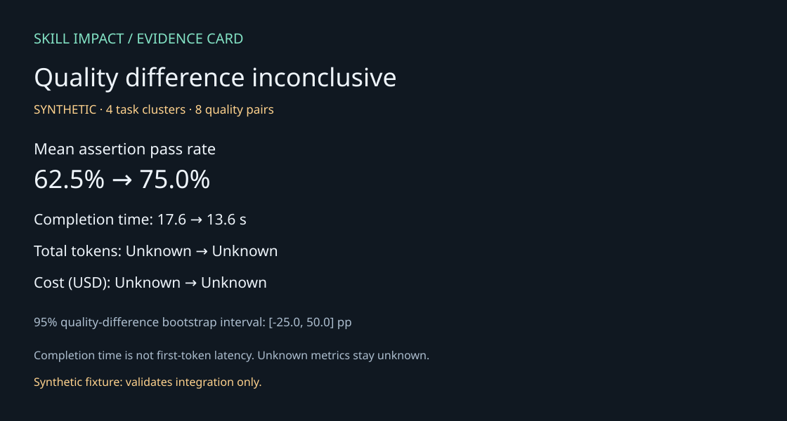

# Skill Impact

**把已有 Agent 评测结果，变成可以核查和交付的证据。**

[English](README.md) · [输入格式](docs/input-formats.md) · [统计口径](docs/methodology.md) · [路线图](docs/roadmap.md)

面向 Skill 作者、Agent 工程师和研究人员：导入已经跑好的实验，比较质量、完成耗时、Token、费用和工具调用，再导出网页、汇报用 SVG 图、CSV、LaTeX 表格及 PR 摘要。不必为了制作报告重新调用模型。

**当前是早期 alpha。内置演示为合成数据，不代表任何真实模型或 Skill 获得了性能提升。真实 Agent 完整运行和外部采用仍待验证。**



## 30 秒体验

需要 Node.js 22.18+ 和 Git。离线体验不需要安装依赖、配置 API key 或调用模型。

```sh
git clone https://github.com/huangzhuzhu75-bit/skill-impact.git
cd skill-impact
node bin/skill-impact.mjs demo --out outputs/demo
```

在浏览器打开 `outputs/demo/report.html`。输出目录必须是新目录，避免覆盖既有证据。

## 导入自己的实验

```sh
node bin/skill-impact.mjs report --input my-iteration/benchmark.json --workspace my-iteration --out outputs/my-report
```

首批支持 Anthropic skill-creator-compatible `runs[]` 和 ctx-eval `trials[]` 两种逐次记录。`--workspace` 可选，用来读取原始 `timing.json`。不声称自动适配所有插件或框架版本。

每项指标分别统计有效配对；缺失值显示“未知”，不会当成零费用或自动判失败。完成耗时不等于首字响应；断言通过率不等于整个任务成功率；字符数不等于 Token。

生成文件：

| 文件 | 用途 |
|---|---|
| `report.html` | 本地浏览、展开任务记录与证据问题 |
| `summary.svg` | 演示稿或技术汇报配图 |
| `metrics.csv` | 表格和进一步分析 |
| `table.tex` | 论文表格片段 |
| `evidence.json` | 来源哈希、归一数据、配对覆盖率和统计结果 |

## 回归检查

```sh
node bin/skill-impact.mjs gate --evidence outputs/my-report/evidence.json --markdown outputs/my-report/pr-summary.md --json outputs/my-report/gate.json
```

退出码：0 在配置策略范围内；1 超出回归阈值；2 数据不足或配置错误。默认要求质量与耗时配对完整；未知的可选指标保留说明。默认阈值是工程策略，不是统计显著性标准。合成数据默认不能通过真实门禁。

## 作为 Skill 使用

入口是 [`skills/skill-impact/SKILL.md`](skills/skill-impact/SKILL.md)。让兼容的 Agent 读取此文件，或按其支持的方式安装该目录。可以这样提出任务：

> 使用 Skill Impact 比较这份 iteration 的实验结果。展示质量、耗时、Token／费用和缺失证据，导出报告与 PR 摘要，不要重新调用模型。

也可通过单独的 Vercel Skills CLI 下载：

```sh
npx skills add huangzhuzhu75-bit/skill-impact --skill skill-impact
```

该命令会下载外部工具和 Skill；不是离线运行的必要条件。本项目与 Vercel、Anthropic、OpenAI 没有官方隶属关系。

## 当前边界

- 来源哈希只能识别文件，不证明数据真实或实验没有混杂因素。
- 小样本区间只适用于观测任务，不能证明普遍提升。
- 模型、权限、任务、重试与评分规则是否一致，需要核对原始实验。
- 实验性编码 Agent runner 会使用相应 CLI 的账号与额度；它与免费的离线报告路径分开。
- Git worktree 不是容器安全沙箱，不应在生产机器执行不可信任务。

运行测试：`node --test "tests/**/*.test.ts"`。

[贡献说明](CONTRIBUTING.md) · [安全说明](SECURITY.md) · [社区规范](CODE_OF_CONDUCT.md) · [MIT 许可证](LICENSE)
